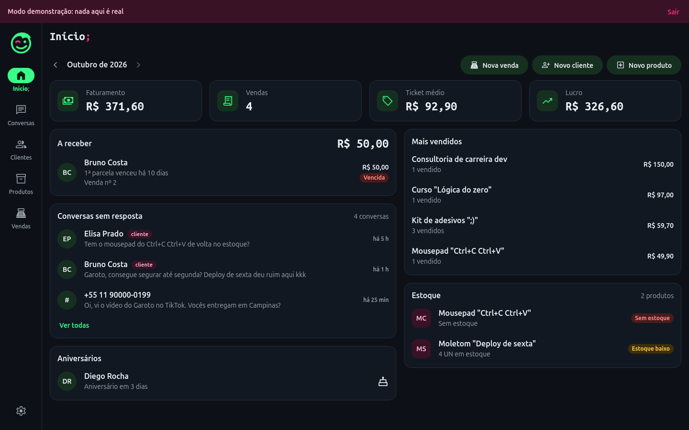
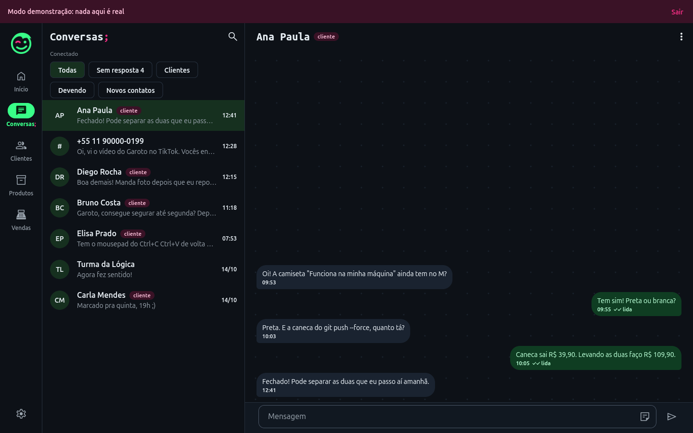
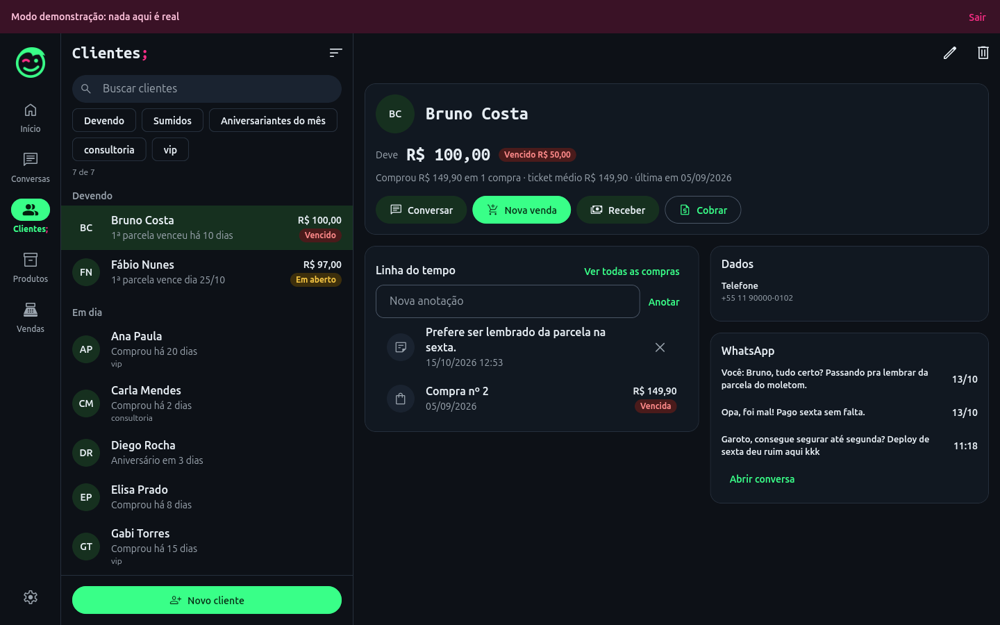
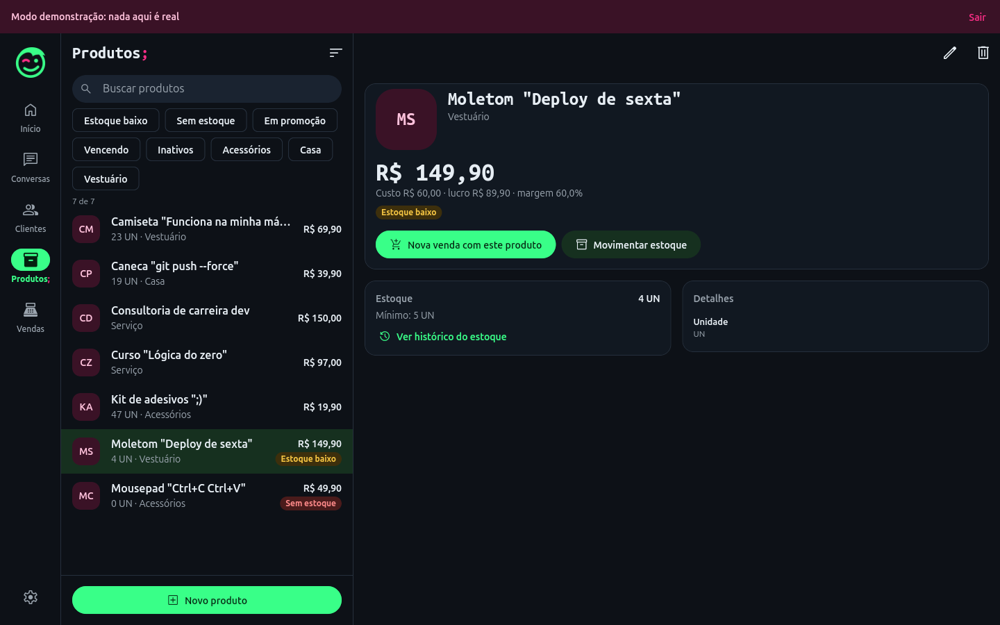
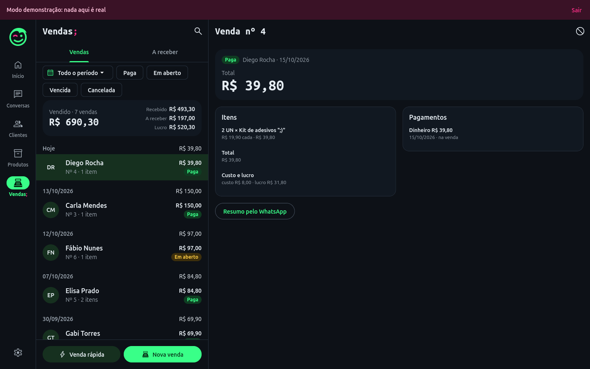

<p align="center">
  
</p>

<h1 align="center">Chat do Garoto;</h1>

<p align="center">
  <b>Suas conversas do WhatsApp, seus clientes e suas vendas num lugar só.</b><br>
  Tudo cifrado no seu aparelho. Sem servidor, sem nuvem, sem rastreio. Duvida? Roda.
</p>

<p align="center">
  <a href="../../actions/workflows/testes.yml"></a>
  
  
  
</p>

Feito pelo [Garoto do Programa;](https://instagram.com/garotodoprograma) · sistema grátis pra comunidade · Android e Linux.

| Início | Conversas | Clientes |
| --- | --- | --- |
|  |  |  |
| **Produtos** | **Vendas** | **No celular** |
|  |  |  |

<sub>// prints do modo demonstração, tirados do app rodando de verdade. Todo nome e número aí é inventado.</sub>

**Um app só, todos os tamanhos.** No computador e no tablet deitado: barra lateral, lista e a conversa (ou a ficha) ao lado, como no WhatsApp Desktop; em monitor grande, a ficha do cliente fica fixa ao lado da conversa. No tablet em pé: barra lateral e uma coluna. No celular: barra de abas embaixo. Conferido em celular, tablet, notebook, monitor e ultrawide, com a fonte em 200%.

## experimenta em 1 minuto (sem conectar nada);

```bash
cd app
flutter run -d linux
```

Na primeira tela, toca em **"Explorar sem conectar"**. Abre uma loja de mentira com clientes, produtos, vendas e conversas. Manda uma mensagem e o "cliente" responde sozinho.
Na demonstração nada é gravado no disco, nada vai pra internet e o WhatsApp nem é conectado.

## o que faz;

- **Conversas:** conecta o seu WhatsApp como aparelho vinculado (código ou QR Code). Texto, foto, áudio, vídeo, documento, encaminhar, apagar pra todos.
- **Clientes:** a conversa vira ficha. Anotações, etiquetas, aniversário, quanto comprou e quanto deve. Toca no nome na conversa e a ficha abre.
- **Produtos:** variações (tamanho, cor), estoque com histórico, custo médio, promoção, atacado, foto, leitor de código de barras.
- **Vendas:** Pix, dinheiro, cartão, fiado em parcelas, a receber, vencidas. O "Cobrar" escreve a mensagem na caixa da conversa e **você** decide se envia.
- **Início:** o que importa hoje: parcela vencida, aniversário, conversa sem resposta, estoque acabando.
- **Segurança:** PIN e digital, banco cifrado, backup cifrado que só você abre, apagar que apaga de verdade.

## aviso (sem esconder);

O app conecta ao WhatsApp pela [whatsmeow](https://github.com/tulir/whatsmeow), que **não é oficial**. O WhatsApp pode banir número que usa cliente não oficial.
Testa com um número descartável, nunca manda mensagem em massa e usa por sua conta e risco.
O app funciona enquanto o WhatsApp oficial do seu celular for aberto pelo menos a cada 14 dias.

## como foi feito (a parte que interessa pra dev);

**Go + Flutter conversando por FFI.** O motor do WhatsApp é Go (whatsmeow), compilado como biblioteca C (`c-shared`) e chamado do Flutter por `dart:ffi`, com bindings gerados pelo `ffigen`. Os eventos voltam do Go pro Dart por callback nativo. O Flutter compila o Go sozinho, no Linux e no Android, por um build hook. (0007)

**Privacidade de verdade, não de propaganda:**
- dois bancos SQLCipher: o do app (`app.db`, Drift) e o da sessão do WhatsApp (`wa.db`, no Go);
- chaves no cofre do sistema: Android Keystore e libsecret no Linux;
- PIN que abre a chave por Argon2id + AES-256-GCM;
- mídias cifradas que só passam pela memória;
- backup cifrado com senha;
- `secure_delete` pra apagar de verdade e captura de tela bloqueada no Android.

Nada de criptografia inventada: só biblioteca reconhecida. (0019)

**Feito com processo, do jeito que time sério faz:**
- **408 testes no app e 131 no Go**, rodando a cada envio no GitHub;
- o guia de desenvolvimento, com as regras do código: [`CONTRIBUINDO.md`](CONTRIBUINDO.md).

## como rodar de verdade;

Precisa de **Go 1.27** e **Flutter 3.47**. Pro Android, também o Android SDK e o NDK 30.0.16248370.

```bash
cd app
flutter pub get
flutter run -d linux        # no computador
flutter run -d <celular>    # no Android (flutter devices mostra o nome)
```

Os testes:

```bash
cd core && go test ./...
cd ../app && flutter test
```

| pasta | o que é |
| --- | --- |
| `app/` | app Flutter: telas, clientes, produtos, vendas, banco local e a demonstração (`lib/src/demo/`) |
| `core/` | motor em Go (whatsmeow), exportado como biblioteca via FFI |
| `docs/` | Capturas de tela usadas neste README |

## quem fez;

**Garoto do Programa;** Dev brasileiro: Go, Flutter, segurança e sistemas que funcionam fora da minha máquina também. Faço sistema grátis pra comunidade e ensino programação começando pela lógica.

**Aberto a trabalho e a projetos.** Gostou do código? Chama.

[](https://instagram.com/garotodoprograma)
[](https://tiktok.com/@garotodoprograma)
[](https://github.com/garotodoprograma404)

## licença;

GPL-3.0 ([`LICENSE`](LICENSE)). Vem do `libsignal`, usado pelo whatsmeow, que também é GPL-3.0: quem distribuir o app precisa abrir o código sob a mesma licença.
As fontes vão com as licenças delas: Ubuntu Sans e Ubuntu Sans Mono (Ubuntu Font Licence).

<sub>// feito pelo Garoto do Programa; · código aberto, humor duvidoso;)</sub>
